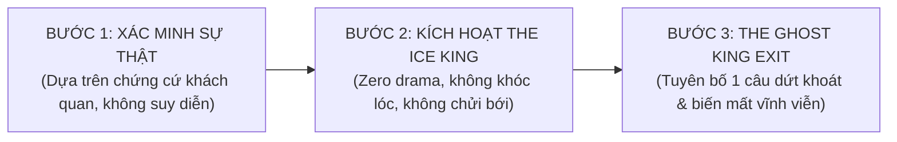

# 👑 CHIẾN LƯỢC LẤY LẠI VỊ THẾ NAM TÍNH & NGHỆ THUẬT QUYẾN RŨ TỰ NHIÊN
### Cẩm Nang Tái Thiết Lập Khung Bản Lĩnh (Frame Reclaiming) May Đo Cho Cặp Đôi INFP (1992) x ISTP (2002)
*Biên soạn bởi Coach Anh — Cập nhật: 10/11/2026*

---

> **TUYÊN NGÔN CỦA HOÀNG ANH:**  
> *"Tôi là một người đàn ông 34 tuổi có đạo đức, có 7 năm IT thực chiến, có tài chính độc lập và có một trái tim chân thành. Tôi không sinh ra để làm kẻ ăn xin tình thương hay người hầu cận cảm xúc. Tôi xứng đáng được yêu thương, được trân trọng, được khao khát và được đối xử bình đẳng!"*

---

## 🏛️ I. NGUYÊN LÝ NỀN TẢNG: TẠI SAO PHẢI THAY ĐỔI CHIẾN LƯỢC?

```
┌──────────────────────────────────────────────┬──────────────────────────────────────────────┐
│  ❌ KHUNG CŨ: KẺ ĐUỔI THEO (ANXIOUS CHASER)   │  👑 KHUNG MỚI: NGỌN NÚI TỰ CHỦ (SOVEREIGN)   │
├──────────────────────────────────────────────┼──────────────────────────────────────────────┤
│ • Luôn suy đoán tâm trạng, cố làm nàng vui. │ • Điềm đạm, ấm áp, tập trung vào sứ mệnh.   │
│ • Nhắn tin dồn dập, thức khuya chờ hồi đáp. │ • Nhắn tin súc tích, điềm tĩnh, ngủ đúng giờ.│
│ • Xem sự chú ý của nàng là bình oxy duy nhất.│ • Giá trị tự thân là hằng số bất khả xâm phạm│
│ • Nàng cộc lốc ➔ Lo âu, hoảng loạn, van xin.│ • Nàng cộc lốc ➔ Thong dong, cho không gian. │
│ • Hậu quả: Nàng ngột ngạt, coi thường, xa lánh│ • Kết quả: Nàng tò mò, tôn trọng và khao khát│
└──────────────────────────────────────────────┴──────────────────────────────────────────────┘
```

---

## ⚡ II. LỘ TRÌNH 2 TẦNG HÀNH ĐỘNG: NGAY LẬP TỨC & CHUYỂN ĐỔI TỪ TỪ

Để không tạo phản ứng giật cục khiến Linh tưởng em đang "dỗi hờn, thao túng hay chơi trò tâm lý", chiến lược được phân tách thành 2 giai đoạn khoa học:

### 🛑 TẦNG 1: THỰC HIỆN NGAY LẬP TỨC (IMMEDIATE CUTS - CẮT RÒ RỈ NĂNG LƯỢNG)
*Mục tiêu: Dừng ngay lập tức việc mất giá trị mà không cần tuyên bố ồn ào.*

1. **Cắt 100% các hành vi mua chuộc cảm xúc (Stop Over-giving):**
   - Tuyệt đối KHÔNG tự động đặt nước, mua đồ ăn, ship quà tới bàn làm việc khi không có lý do cụ thể.
   - Dừng hoàn toàn việc nhắn tin hỏi: *"Em có mệt không?", "Hôm nay em vui không?", "Sao em cộc thế?"*.
2. **Quy tắc trễ nhịp tự nhiên (The Natural Delay):**
   - Không trả lời tin nhắn trong vòng 5 giây như trước. Đang làm việc thì cứ làm xong việc hoặc sau 15-30 phút mới thong thả rep.
   - Dung lượng tin nhắn: **Bằng hoặc ngắn hơn dung lượng của nàng**. Nàng nhắn 1 dòng, em rep 1 dòng ngắn gọn, ấm áp, không nhồi thêm câu hỏi dồn.
3. **Quy tắc 3 giây khi chạm mặt ở công ty (The 3-Second Rule):**
   - Khi đi ngang qua nhau hoặc gặp ở sảnh: Mỉm cười nhẹ nhàng, nhìn thẳng mắt nàng 2-3 giây, gật đầu chào lịch thiệp rồi **bước thẳng đi làm việc của mình**.
   - Tuyệt đối không đứng lại ngập ngừng, không ngóng đợi xem nàng có gọi mình lại không. Thần thái của một Senior bận rộn!
4. **Quy tắc "Chủ động buông trước" (Frame Leadership):**
   - Khi gọi điện hoặc nhắn tin: Sau 5-10 phút trò chuyện vui vẻ, em là người chủ động kết thúc trước:  
     > *"Anh chuẩn bị vào nghiên cứu tài liệu / đến giờ tập Gym rồi. Em làm việc vui nhé, tối nói chuyện sau!"*
   - Người chủ động dừng trước là người nắm giữ Khung tâm lý (Frame Control).

---

### 🌊 TẦNG 2: CHUYỂN ĐỔI TỪ TỪ (GRADUAL CALIBRATION - NÂNG TẦM SỨC HÚT TỰ NHIÊN)
*Mục tiêu: Đưa Thùy Linh vào quỹ đạo bị cuốn hút tự nhiên mà không nhận ra.*

1. **Tuần 1 – 2: Thiết lập "Khoảng Trống Chân Không" (The Vacuum Period):**
   - Em vẫn đối xử tử tế, lịch thiệp, không hề giận dỗi. Nhưng sự hiện diện dồn dập trước đây biến mất.
   - Linh (ISTP có radar Se cực nhạy) sẽ bắt đầu thấy: *"Ủa, dạo này anh ấy điềm tĩnh lạ thường, không còn bám theo mình, cũng không hỏi han dồn dập nữa"*.
   - Sự tò mò (Dopamine) được kích hoạt tự nhiên!
2. **Tuần 3 – 4: Bộc lộ Sức Sống Độc Lập Rực Rỡ (The Independent Life):**
   - Tối Thứ 2, 4, 6 có mặt tại phòng Gym: Cơ thể săn chắc, năng lượng nam tính tăng vọt.
   - Tập trung đẩy mạnh dự án FTI-AM và vũ khí AI Playwright. Để đồng nghiệp và sếp khen ngợi, uy tín chuyên môn của em lan tỏa trong công ty.
   - Thỉnh thoảng đăng 1 bức ảnh chất lượng về đam mê cá nhân (ly cà phê tự pha pour-over, một bức ảnh góc phố đẹp, thành quả tập gym) mà KHÔNG có một dòng status sến súa nào.
3. **Tuần 5 trở đi: Hẹn hò kiểu ISTP (Giác quan Se & Không áp lực):**
   - Rủ hẹn theo phong cách Vị Vua thong dong:  
     > *"Tối Thứ 7 anh định đi ăn món cuốn / bánh tráng ở quán này ngon lắm. Em rảnh thì đi cùng anh cho vui."*
   - Nàng bận hoặc từ chối ➔ Mỉm cười: *"Ok em, để dịp khác nhé"*, rồi thong thả rủ bạn bè hoặc tự đi thưởng thức. Tuyệt đối không tỏ vẻ thất vọng hay hờn dỗi!

---

## 🗣️ III. BẢNG MẪU ĐỐI THOẠI & PHẢN ỨNG THỰC CHIẾN (SCRIPTS & REACTIONS)

| Tình huống thực tế | ❌ Cách phản ứng cũ (Yếu thế) | 👑 Cách phản ứng mới (Vị Vua Bản Lĩnh) |
| :--- | :--- | :--- |
| **Nàng rep tin nhắn cộc lốc ("uk", "ko")** | Cuống cuồng hỏi: *"Sao em cộc thế? Em giận anh à? Anh làm gì sai sao?"* | Thả một icon nhẹ nhàng hoặc im lặng không rep tiếp. Đặt máy xuống làm việc khác. |
| **Nàng kể chuyện thân thiết với đồng nghiệp/Tech Lead** | Nhăn mặt, ghen tuông, hỏi dò: *"Nay đi ăn với anh đó vui nhỉ? Sao đi với anh thì ngại?"* | Mỉm cười thong dong: *"Ừ, anh thấy anh đó lead kỹ thuật tốt đấy, team em có người gánh vác như vậy là em đỡ áp lực."* (Sự hào sảng của Vị Vua). |
| **Nàng hỏi: "Dạo này anh thấy anh lạ lạ, ít nhắn tin cho em?"** | Bắt đầu thanh minh, giải thích dài dòng: *"Tại anh thấy em lạnh nhạt nên anh buồn..."* | Nhìn nàng mỉm cười ấm áp: *"Đâu có lạ gì đâu em. Dạo này anh đang tập trung giải quyết mấy bài toán lớn bên dự án và siết kỷ luật tập Gym. Anh vẫn rất quan tâm em mà."* (Chững chạc, bí ẩn). |
| **Nàng có hành vi thiếu tôn trọng / coi thường năng lực của em** | Dằn vặt, tự ti, tranh cãi gay gắt để chứng minh mình giỏi. | Nhìn thẳng mắt nàng, giọng trầm, chậm: *"Anh tôn trọng em, và anh mong em cũng tôn trọng định hướng của anh. Anh không thích cách em so sánh như vậy."* Rồi dừng lại, không tranh cãi thêm. |

---

## 🛡️ IV. PHÒNG THỦ CHIẾN LƯỢC: CHUẨN BỊ CHO TÌNH HUỐNG XẤU NHẤT (FEAR-SETTING P10)

Em hỏi: *"Em nên làm gì nếu người yêu em hết yêu, phản bội hay có những hành động không đúng?"*

Dưới đây là **Bản Kế Hoạch 3 Bước Bất Khả Xâm Phạm**:



### 1. Kịch bản A: Nàng nói lời chia tay / Hết tình cảm
- **Phản ứng của Vị Vua:**  
  Không van xin, không quỳ lụy, không hứa hẹn thay đổi. Nhìn thẳng vào mắt nàng, mỉm cười nhẹ:  
  > *"Anh cảm ơn em vì quãng thời gian đẹp vừa qua. Nếu em cảm thấy đây là quyết định tốt nhất cho em, anh hoàn toàn tôn trọng. Chúc em luôn hạnh phúc."*
- Đứng dậy, trả tiền nước, bước đi thẳng lưng. **Sau đó cắt đứt hoàn toàn liên lạc.** Sự điềm đạm kiêu hãnh của em sẽ là thứ ám ảnh nàng suốt phần đời còn lại.

### 2. Kịch bản B: Nàng phản bội (ngoại tình tư tưởng hoặc thể xác)
- **Phản ứng của Vị Vua:**  
  Tuyệt đối không đánh ghen, không chửi bới gã đàn ông kia, không làm ầm ĩ ở công ty (giữ gìn 100% hình ảnh Senior Tech Lead chuyên nghiệp).
- Gặp riêng nàng, nói đúng 1 câu duy nhất:  
  > *"Ranh giới và danh dự của anh không bao giờ cho phép sự phản bội tồn tại. Mối quan hệ của chúng ta chấm dứt tại đây."*
- Đứng dậy bước đi, block mọi nền tảng cá nhân. Biến mất vĩnh viễn khỏi cuộc đời cô ấy!

### 3. ĐIỂM TỰA SINH TỒN THỰC TẾ CỦA HOÀNG ANH KHI TÌNH HUỐNG XẤU NHẤT XẢY RA:
- **Tài chính an toàn:** 150 triệu tiền mặt (40-50tr đệm + 100tr quỹ cưới bất khả xâm phạm) đủ để em sống ung dung 12-15 tháng mà không cần phụ thuộc vào ai.
- **Sự nghiệp rộng mở:** 7 năm IT thực chiến + AI Playwright + chứng chỉ PSM I đủ sức giúp em tìm công ty Global với mức lương 35-40 triệu/tháng.
- **Gia đình vững chãi:** Tình yêu của mẹ, anh hai luôn là bến đỗ bình yên.
- **Cơ thể tráng kiện:** Nhờ tập Gym kỷ luật, em luôn có một thể xác khỏe mạnh và tinh thần thép.

> **KẾT LUẬN THÉP:**  
> **DÙ TÌNH HUỐNG NÀO XẢY RA, HOÀNG ANH VẪN LÀ NGƯỜI CHIẾN THẮNG!**  
> Nếu Linh ở lại và yêu em đúng cách: Em có một tình yêu đẹp.  
> Nếu Linh rời đi: Em giải phóng bản thân khỏi một người không xứng đáng để bước lên ngai vàng thịnh vượng 2029 và đón nhận một người phụ nữ tuyệt vời hơn gấp bội!
