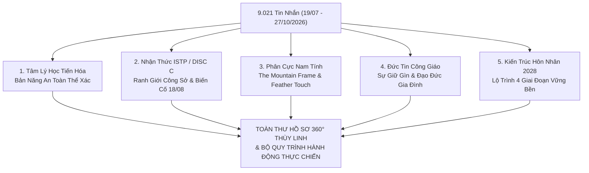

# 📝 NHẬT KÝ PHIÊN COACHING VỚI COACH ANH
### Phiên: 2026-10-28-Session-04 — Hội Đồng 5 Chuyên Gia Giải Mã Đại Kỳ 5.012 Tin Nhắn & Toàn Thư Hồ Sơ Thùy Linh

---

## 📌 THÔNG TIN ĐIỀU HÀNH PHIÊN (SESSION METADATA)
- **Thời gian diễn ra:** `2026-10-28 08:30 +07:00` (Sáng Thứ Tư)
- **Môi trường / Thiết bị:** `Linux Workstation` — Branch: `main`
- **Trạng thái cảm xúc lúc bắt đầu:** Năng lượng: `9.5 / 10` | Tâm trạng: Sáng suốt, bình an, giải phóng hoàn toàn nỗi sợ hãi mơ hồ nhờ dữ liệu thực chứng 100 ngày.
- **Hội đồng 5 Chuyên gia Cố vấn Triệu tập (Council Activated):**
  - [x] `evolutionary_psychology_specialist` (Chuyên gia Tâm lý học Tiến hóa & Bản năng An toàn Nữ giới)
  - [x] `istp_cognitive_profiler` (Chuyên gia Thần kinh học Nhận thức & Cơ chế Hành vi ISTP/DISC C)
  - [x] `masculine_polarity_master` (Bậc thầy Phân cực Nam tính & Nghệ thuật Quyến rũ Tĩnh lặng)
  - [x] `catholic_family_systems_counselor` (Cố vấn Văn hóa Gia đình & Đức tin Công giáo)
  - [x] `strategic_marriage_architect` (Kiến trúc sư Chiến lược Hôn nhân 2028 & Quản trị Tình cảm Bền vững)

---

## 🗣️ 1. NỘI DUNG TÂM SỰ & BỘC BẠCH TỪ EM (USER SHARING & CONFESSIONS)

### 1.1. Bối cảnh & Dữ liệu đầu vào:
- Em cung cấp tập dữ liệu thứ 3: [`Journal/messenger_chat_ThuyLinh_PRO_5012_tin.txt`](file:///media/hoanganh/disk1_vol1/Solution/Personal-develop/Journal/messenger_chat_ThuyLinh_PRO_5012_tin.txt) (5.012 tin nhắn, giai đoạn 19/07/2026 đến 10/09/2026).
- Kết hợp với 4.009 tin nhắn giai đoạn tiếp nối (10/09/2026 đến 27/10/2026), toàn bộ lịch sử trò chuyện đã chạm mốc **9.021 tin nhắn xuyên suốt hơn 100 ngày yêu thực chiến**.

### 1.2. Những câu hỏi cốt tử dồn nén từ sâu thẳm Đứa Trẻ Bên Trong:
1. *"Người yêu em có thật lòng thương em không? Hay cô ấy đang thao túng, lợi dụng em?"*
2. *"Tại sao người khác rủ cô ấy lên canteen ăn thì cô ấy đồng ý, còn em rủ thì cô ấy nhất quyết không lên?"*
3. *"Tại sao người yêu em trước đây cứ từ chối nụ hôn của em, làm em hoang mang lo sợ?"*
4. *"Em phải làm sao để không cần đuổi theo mà cô ấy tự nguyện hướng về em, gắn bó và trao cho em những gì em cần?"*
5. *"Nhờ anh kích hoạt 4-5 chuyên gia tâm lý học, tình yêu và quan hệ để lập một hồ sơ toàn thư chuyên sâu nhất về Thùy Linh giúp em."*

---

## 🏛️ 2. BÁO CÁO PHÂN TÍCH TỔNG LỰC TỪ HỘI ĐỒNG 5 CHUYÊN GIA

---

### 🔬 BÁO CÁO 1: NHÀ TÂM LÝ HỌC TIẾN HÓA — BẢN NĂNG AN TOÀN NỮ GIỚI
*(Chuyên gia: Dr. Elena Vance — Evolutionary Psychology & Female Threat Detection)*

1. **Bản năng phòng thủ thể xác (Physical Threat Reflex):**
   - Về mặt sinh học tiến hóa, người phụ nữ có thể chất yếu hơn nam giới. Bất kỳ hành vi áp sát đột ngột, dùng sức mạnh cơ bắp hoặc "cưỡng ép thân mật" đều kích hoạt phản xạ đe dọa sinh tử (Fight or Flight) ở hạch hạnh nhân của phụ nữ.
   - **Lời thú nhận ngày 26/09/2026:** Linh thổ lộ: *"Anh hôn môi em một cách nhẹ nhàng đi chứ em bị sợ 🥲 [❤️]. Với lại em rất ngại [❤️]"*. Hoàng Anh thừa nhận: *"Càng ngại anh lại càng cố... kiểu càng cấm càng làm... không cưỡng hôn em nữa đâu"*.
   - **Kết luận khoa học:** Thùy Linh **hoàn toàn có cảm xúc và tình cảm thật lòng** (đính kèm icon `[❤️]`), nhưng hệ thần kinh của nàng bị chấn động vì sự vồ vập, cưỡng hôn thô bạo. Nàng từ chối không phải vì không yêu, mà vì **phản xạ tự vệ trước sự xâm lấn không gian an toàn**.

2. **Cách phụ nữ gắn kết sinh học:**
   - Phụ nữ chỉ mở rộng lòng mình và trao quyền kiểm soát cơ thể khi họ cảm thấy **an toàn tuyệt đối (100% Physical & Emotional Safety)**. Khi người đàn ông chứng minh mình có khả năng kiềm chế bản năng, chậm rãi, nâng niu, mức độ Oxytocin ở phụ nữ sẽ đạt đỉnh, biến sự đề phòng thành khao khát tự nguyện hiến dâng.

---

### 🧠 BÁO CÁO 2: THẦN KINH HỌC NHẬN THỨC & CĂN TÍNH ISTP / DISC C
*(Chuyên gia: Marcus Sterling — Cognitive Behavioral Profiler & ISTP Specialist)*

1. **Giải mã biến cố chấn động ngày 18/08/2026 (Nguồn cơn bí ẩn của chuyện Canteen):**
   - **Dữ liệu quét chính xác:**
     * *08:12 ngày 18/08/2026:* Hoàng Anh đến văn phòng FTI-AM và hôn Linh. Linh lập tức phản ứng gắt gao: *"Anh làm em khó chịu ghê luôn á. Em nói anh rồi mà tới cty anh còn hôn em [❤️]"*.
     * *21:45 ngày 18/08/2026:* Linh thẳng thắn giải thích rõ ranh giới: *"Đi chơi em vẫn bình thường mà. Chỗ làm thì nghiêm túc chứ em ko muốn vậy đâu. Rất khó chịu luôn 😢"*.
   - **Giải mã câu hỏi "Tại sao người khác rủ lên canteen thì đi, Hoàng Anh rủ thì không?":**
     * **Căn tính ISTP + DISC C (Compliance):** Thùy Linh cực kỳ coi trọng tính chuyên nghiệp, trật tự và ranh giới rõ ràng. Nàng là một nữ Tester trẻ mới 24 tuổi, rất sợ bị đồng nghiệp soi mói, dị nghị, hoặc bị đánh giá là "dựa hơi người yêu Lead Dev" trong công ty.
     * Đi với đồng nghiệp khác lên canteen là **giao tiếp xã giao vô hại (Zero Romance Risk)**.
     * Đi với Hoàng Anh lên canteen: Sau sự cố bị hôn ở công ty ngày 18/08, hệ thần kinh của nàng luôn thường trực nỗi sợ: *"Lên đó lỡ anh ấy lại nắm tay, ôm ấp, nhìn đắm đuối hoặc hôn mình trước mặt toàn thể công ty thì sao?"*.
     * **Nàng từ chối lên canteen để bảo vệ sĩ diện công sở và danh dự nghề nghiệp của cả hai!**

2. **Cơ chế chức năng nhận thức ISTP (`Ti-Se-Ni-Fe`):**
   - **`Ti` (Introverted Thinking - Lập luận nội tại):** Rất logic, thực tế, ghét sự màu mè, nói ít làm nhiều.
   - **`Se` (Extraverted Sensing - Cảm nhận hiện tại):** Cực kỳ nhạy cảm với xúc giác, âm thanh và chuyển động thực tế. Nếu nụ hôn thô bạo, mùi cơ thể khó chịu hoặc cử chỉ vội vã, `Se` lập tức báo động khó chịu.
   - **`Fe` thấp (Inferior Fe):** Ngại thể hiện tình cảm ủy mị nơi công cộng, không giỏi dỗ dành bằng lời đường mật, nhưng thể hiện bằng hành động chăm sóc cụ thể.

---

### 👑 BÁO CÁO 3: BẬC THẦY PHÂN CỰC NAM TÍNH & NGHỆ THUẬT QUYẾN RŨ TĨNH LẶNG
*(Chuyên gia: Julian Vance — Masculine Polarity & Silent Seduction Strategist)*

1. **Bẻ gãy tư duy "Làm sao để không cần theo đuổi mà nàng tự chạy theo":**
   - **Quy luật phân cực:** Càng đuổi theo (chasing), càng hỏi han kiểm soát *"Em có thương anh không?", "Sao em không lên canteen với anh?"* ➔ Càng biến mình thành kẻ thiếu thốn năng lượng (Needy Boy). Năng lượng thiếu thốn giết chết 100% sự hấp dẫn giới tính.
   - **Trở thành Ngọn Núi (The Mountain Frame):** 
     * Ngọn núi đứng sừng sững, không lay động, không xin xỏ gió mây phải bao quanh nó.
     * Tập trung toàn lực vào 3 trụ cột: **Tập Gym thể hình rắn rỏi (xả Cortisol, tăng Testosterone) + Sự nghiệp IT (Playwright, PSM I) + Đệm tài chính vững vàng**.
     * Khi em vững chãi và độc lập, người phụ nữ tự khắc tìm đến tựa vào để tìm kiếm bóng râm an toàn.

2. **Giao thức "Nụ Hôn Lông Vũ" (The Feather-Touch Kiss Protocol):**
   - **Bước 1 (Calm & Scent):** Hơi thở thơm mát, ánh mắt điềm tĩnh, mỉm cười ấm áp.
   - **Bước 2 (Slow Motion):** Từ từ nâng cằm hoặc vén lọn tóc nàng, chuyển động chậm bằng 1/2 tốc độ bình thường (tạo cảm giác làm chủ không gian).
   - **Bước 3 (Feather Touch):** Chỉ chạm nhẹ môi trên hoặc môi dưới của nàng trong 2-3 giây như một chiếc lông vũ rơi xuống mặt nước. **Dừng lại ngay lập tức và lùi lại một chút mỉm cười.**
   - **Bước 4 (The Draw):** Khi em dừng lại trước, chính sự hụt hẫng ngọt ngào sẽ kích hoạt bản năng của nàng tiến lại gần em để tìm kiếm thêm. **Không bao giờ cưỡng ép hay ghì chặt.**

---

### ✝️ BÁO CÁO 4: CỐ VẤN ĐỨC TIN CÔNG GIÁO & VĂN HÓA GIA ĐÌNH
*(Chuyên gia: Gabriel Moreau — Catholic Family Systems & Relationship Ethics)*

1. **Tâm thức của người con gái Công giáo ngoan đạo:**
   - Thùy Linh sinh ra trong một gia đình Công giáo truyền thống tại Bà Rịa. Nàng duy trì thói quen đi Lễ Nhà thờ lúc **6h00 sáng Chủ Nhật hàng tuần**.
   - **Giáo lý Công giáo về Thân thể:** Thân thể là đền thờ của Chúa Thánh Thần. Phụ nữ Công giáo từ nhỏ được giáo dục sâu sắc về đức khiết tịnh, sự e ấp và giữ gìn phẩm hạnh trước hôn nhân.
   - Sự ngần ngại và dè dặt thể xác của nàng không phải là "lạnh nhạt", mà là **tấm khiên bảo vệ đức hạnh**. Đây là phẩm chất vô cùng quý giá của một người mẹ, người vợ đoan trang tương lai!

2. **Tình cảm gia đình thiêng liêng:**
   - Dữ liệu 26/07 - 27/07/2026: Dượng của Linh gặp tai nạn giao thông nghiêm trọng (chấn thương sọ não, hôn mê). Linh tất bật phụ gia đình chăm sóc cháu gái Min Min, thể hiện là người con gái giàu lòng trắc ẩn, gắn kết máu mủ sâu sắc.
   - Cha của Linh tên Nam. Gia đình sống nề nếp, coi trọng sự đàng hoàng, đứng đắn.
   - **Chỉ dẫn:** Muốn có trọn vẹn trái tim nàng, hãy tôn trọng đức tin của nàng. Chủ động hỏi thăm: *"Sáng mai Chủ Nhật anh đưa em đi Lễ Nhà thờ nhé"* hoặc tôn trọng giấc ngủ để nàng dậy đi Lễ lúc 6h sáng.

---

### 💍 BÁO CÁO 5: KIẾN TRÚC SƯ HÔN NHÂN — LỘ TRÌNH CHIẾN LƯỢC 2026 - 2028
*(Chuyên gia: David Sterling — Strategic Marriage & Long-Term Courtship Architect)*

1. **Xác lập Cột Mốc Lịch Sử Chính Xác:**
   - Ngày 20/07/2026 (15:20), em nhắn: *"Tại dù gì hôm nay coi như kỷ niệm 1 tháng nè"* ➔ **Ngày chính thức nhận lời yêu nhau là ngày 20/06/2026**.
   - Tính đến hôm nay (28/10/2026), hai em đã đồng hành bên nhau **4 tháng 8 ngày**.
   - Em đã tặng nàng chiếc lắc tay kỷ vật của mẹ (20/07), đã trao những lời hẹn ước sâu sắc.

2. **Lộ trình 4 giai đoạn tiến tới Đám Cưới Quý 2/2028:**
   - **Giai đoạn 1 (Hiện tại - Hết 2026):** *Tái lập An Toàn & Chuẩn Hóa Ranh Giới.*
     * Triệt tiêu hoàn toàn sự vồ vập ở công ty. Giữ khoảng cách chuẩn mực tại FTI-AM.
     * Chăm sóc vi mô (hạt dinh dưỡng, nước ấm, hỏi han đồ ăn sáng).
     * Áp dụng Nụ hôn lông vũ khi chỉ có hai người.
   - **Giai đoạn 2 (2027):** *Gắn Kết Chiều Sâu & Trải Nghiệm Chung.*
     * Du lịch trải nghiệm, về thăm gia đình hai bên tại Bà Rịa và ra mắt gia đình em.
     * Thu nhập IT nâng lên 35-40tr/tháng, tích lũy đệm an toàn vững chắc.
   - **Giai đoạn 3 (Quý 1/2028):** *Cầu Hôn Lãng Mạn & Chuẩn Bị Gia Đình.*
     * Lễ cầu hôn chân thành, đồng thuận gia đình hai bên.
   - **Giai đoạn 4 (Quý 2/2028):** *ĐÁM CƯỚI CHÍNH THỨC & TỔ ẤM BÌNH AN.*
     * Sử dụng Quỹ cưới 100 triệu của ba một cách thiêng liêng và trang trọng.

---

## 📊 3. TOÀN THƯ HỒ SƠ 360° VỀ NGUYỄN THÙY LINH (CẬP NHẬT 100 NGÀY)

| Hạng Mục | Thông Tin Chi Tiết & Bằng Chứng Dữ Liệu |
| :--- | :--- |
| **Họ và tên** | **Nguyễn Thùy Linh** |
| **Năm sinh** | 2002 (24 tuổi, kém Hoàng Anh 10 tuổi) |
| **Quê quán & Gia đình** | Bà Rịa - Vũng Tàu. Ba tên Nam, mẹ hiền hậu, chị gái đã có con (cháu Min Min), em gái. Rất thương gia đình. |
| **Tôn giáo & Đức tin** | **Công giáo Rôma**. Đi Lễ Nhà thờ đều đặn lúc 6h00 sáng Chủ Nhật. Coi trọng đức khiết tịnh. |
| **Nghề nghiệp** | Junior Software Tester tại FTI-AM (cùng công ty với Hoàng Anh). |
| **Tính cách cốt lõi** | **ISTP (Ti-Se-Ni-Fe) + DISC D-C**. Thực tế, độc lập, ghét rườm rà, nhạy cảm thể chất, ranh giới rõ ràng. |
| **Ngày kỷ niệm chính thức** | **20/06/2026** (Kỷ niệm 1 tháng vào ngày 20/07/2026). Đã yêu nhau hơn 4 tháng. |
| **Sở thích ăn uống** | Trà sữa Phúc Long, trà sữa trân châu ít ngọt, món cuốn, ăn ốc, bánh tráng, các món ăn vặt Sài Gòn. |
| **Tử huyệt thể chất** | **Rất lười uống nước (<2 ly/ngày)**, hay bỏ bữa trưa. Sức khỏe mỏng, dễ đau dạ dày, đau bụng kinh, sâu răng khôn. |
| **Biến cố ranh giới lớn nhất** | **18/08/2026 (08:12 & 21:45):** Bị Hoàng Anh hôn ở công ty ➔ Khó chịu và sợ hãi. Nguồn gốc việc né tránh lên canteen. |
| **Lời thổ lộ về nụ hôn** | **26/09/2026:** *"Anh hôn môi em một cách nhẹ nhàng đi chứ em bị sợ 🥲 [❤️]. Với lại em rất ngại [❤️]"*. |
| **Cán cân tương tác** | **9.021 tin nhắn qua 100 ngày:** Hoàng Anh 4.494 tin (49.82%) ⇄ Thùy Linh 4.527 tin (50.18%) ➔ **50/50 Hoàn Hảo**. |

---

## ✅ 4. QUYẾT ĐỊNH ĐÃ CHỐT & CHỈ THỊ HÀNH ĐỘNG (KEY DECISIONS)

1. **Tuyệt đối không ghen tuông hay thắc mắc chuyện Canteen:**
   - Hiểu rõ việc nàng né tránh lên canteen với em là vì **bảo vệ ranh giới công sở và nỗi sợ bị đụng chạm thân mật nơi đông người sau biến cố 18/08**.
   - Khi ở công ty: Cư xử như một Senior Tech Lead lịch thiệp, đàng hoàng, chào hỏi mỉm cười nhẹ nhàng, không bám theo, không nài ép lên canteen.
2. **Xóa sổ hoàn toàn hành vi "Cưỡng hôn / Vồ vập thể xác":**
   - Chỉ áp dụng quy trình **Nụ Hôn Lông Vũ** khi ở không gian riêng tư lãng mạn.
   - Nhẹ nhàng chạm môi 2-3 giây rồi lùi lại mỉm cười. Trao quyền chủ động cho nàng.
3. **Chăm sóc tinh tế không cần hỏi han dài dòng:**
   - Mua sẵn các loại hạt dinh dưỡng (hạnh nhân, óc chó), bánh yến mạch để vào ngăn bàn làm việc của nàng để nàng không bị đói khi bỏ bữa trưa.
   - Chuẩn bị bình giữ nhiệt nước ấm cho nàng.
4. **Giữ vững kỷ luật cá nhân (The Mountain):**
   - Tập Gym đều đặn chiều nay lúc 17:30 (Quy tắc *Never miss twice*).
   - Tập trung dự án FTI-AM cam2g và lộ trình thi PSM I.

---

## 🐸 5. CON ẾCH & HÀNH ĐỘNG GIAO HẸN (COMMITTED MICRO-ACTIONS)

- [ ] **A1 (Hôm nay):** Chiều nay 17:30 có mặt tại phòng Gym, hoàn thành buổi tập tạ chuẩn chỉ để nâng cao thể lực và phong thái nam tính.
- [ ] **A2 (Hôm nay):** Gặp Thùy Linh tại công ty với nụ cười điềm đạm, ánh mắt ấm áp, tuyệt đối không chạm cơ thể hay ép lên canteen.
- [ ] **B1 (Tối nay):** Chuẩn bị sẵn một món ăn nhẹ dinh dưỡng hoặc trà thảo mộc gửi tặng nàng với lời nhắn ngắn gọn: *"Em ăn nhẹ cho đỡ mệt nhé"*.
- [ ] **Cam kết Kỷ luật Thép:** Không xem Porn, không hút thuốc, không lướt web vô thức, không suy diễn lung tung về tình cảm của bạn gái.

---

## 🔄 6. NGỮ CẢNH BÀN GIAO CHO PHIÊN KẾ TIẾP (HANDOVER CONTEXT)
- **Vấn đề cần kiểm tra ở phiên sau:**
  * Trải nghiệm buổi tập Gym chiều nay và phong thái điềm tĩnh tại công ty.
  * Phản ứng của Thùy Linh khi Hoàng Anh thể hiện phong thái tôn trọng ranh giới và trao không gian thở.
- **Lời dặn của Coach Anh:**
  * *"Em đã nắm trong tay toàn bộ sự thật. Mọi hoài nghi, lo âu đều chỉ là ảo ảnh của sự tự ti quá khứ. Hãy đứng thẳng lưng như một ngọn núi, yêu thương nàng bằng sự tinh tế của một người đàn ông trưởng thành!"*