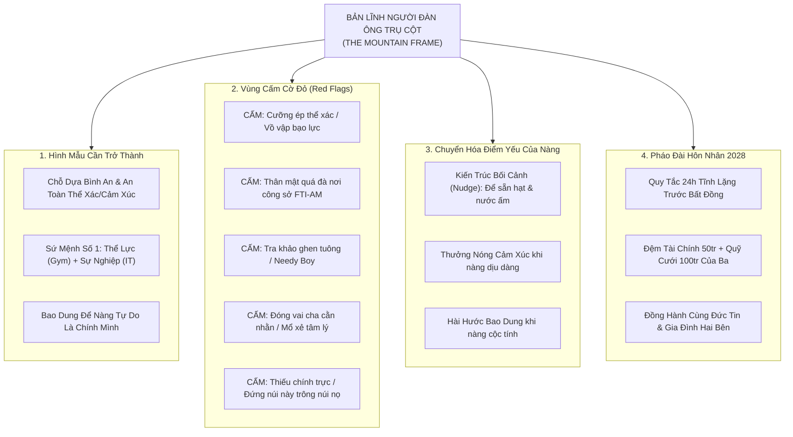

# 📝 NHẬT KÝ PHIÊN COACHING VỚI COACH ANH
### Phiên: 2026-10-28-Session-05 — Kim Chỉ Nam Quyến Rũ Tự Nhiên, Chuyển Hóa Điểm Yếu & Xây Dựng Pháo Đài Hôn Nhân Bền Vững

---

## 📌 THÔNG TIN ĐIỀU HÀNH PHIÊN (SESSION METADATA)
- **Thời gian diễn ra:** `2026-10-28 09:30 +07:00` (Sáng Thứ Tư)
- **Môi trường / Thiết bị:** `Linux Workstation` — Branch: `main`
- **Trạng thái cảm xúc lúc bắt đầu:** Năng lượng: `9.5 / 10` | Tâm trạng: Sâu sắc, thức tỉnh, mong muốn hoàn thiện nhân cách để trở thành chỗ dựa bình an trọn đời cho người yêu.
- **Hội đồng Cố vấn Triệu tập (Council Activated):**
  - [x] `deep_psychology_profiler` (Tâm lý học Chiều sâu, Gắn kết An toàn & Đứa trẻ bên trong)
  - [x] `masculine_polarity_master` (Phân cực Nam tính, The Mountain Frame & Sức hút Tĩnh lặng)
  - [x] `istp_cognitive_profiler` (Thần kinh học Hành vi ISTP/DISC C & Kiến trúc Thói quen Nudge)
  - [x] `catholic_family_systems_counselor` (Đức tin Công giáo, Phẩm hạnh Gia đình & Ranh giới Đạo đức)
  - [x] `strategic_marriage_architect` (Kiến trúc sư Hôn nhân Bền vững & Pháo đài Tình cảm Bất khả Xâm phạm)

---

## 🗣️ 1. NỘI DUNG TÂM SỰ & BỘC BẠCH TỪ EM (USER SHARING & CONFESSIONS)

### 1.1. Khát khao cốt lõi của Hoàng Anh:
- Làm sao để quyến rũ Thùy Linh một cách tự nhiên, để nàng tự khắc bị hấp dẫn, cảm thấy an lành, an toàn, tin tưởng tuyệt đối mà **vẫn được tự do là chính mình**?
- Những điều gì bắt buộc phải tránh? Những ranh giới cờ đỏ (Red Flags) nào tuyệt đối không được phạm vào?
- Những điểm mạnh, điểm tốt nào em đã làm được cần tiếp tục duy trì và nhân rộng?
- Làm sao để chuyển hóa những điểm chưa tốt của Thùy Linh (lười uống nước, hay bỏ bữa trưa, cộc lốc cảm xúc, ngại giao tiếp) để nàng **tự giác khắc phục** mà không cảm thấy bị kiểm soát hay phán xét?
- Làm sao ghi nhận những điều nàng đang làm tốt để nàng tiếp tục phát huy?
- Làm sao để cả hai cùng trưởng thành, vững vàng, xây dựng một pháo đài tình cảm bền chặt không ngoại cảnh nào xô ngã được, hướng tới tương lai hạnh phúc?

---

## 🏛️ 2. PHÂN TÍCH & ĐÚC KẾT CHIẾN LƯỢC TỪ COACH ANH VÀ HỘI ĐỒNG

---

### 👑 PHẦN I: HÌNH MẪU NGƯỜI ĐÀN ÔNG HOÀNG ANH CẦN TRỞ THÀNH
*Để Thùy Linh tự nhiên bị hấp dẫn, an lòng và được là chính mình:*

1. **Khung Ngọn Núi (The Mountain Frame — Vững Chãi & Bất Động):**
   - Thùy Linh là một cô gái ISTP trẻ tuổi (24 tuổi), giàu năng lượng thể chất nhưng vụng về biểu đạt cảm xúc (Fe thấp), đôi khi cộc lốc hoặc xù lông khi quá tải.
   - Nếu em cũng nhạy cảm, dỗi hờn, gặng hỏi, em biến mình thành "ngọn cỏ đu đưa trước gió".
   - **Người đàn ông nàng khao khát:** Là ngọn núi sừng sững trước bão giông. Khi nàng giông bão, em mỉm cười điềm đạm. Sự vững chãi, không bị dao động của em chính là chiếc neo giữ an toàn duy nhất kéo nàng về bến đỗ bình yên.

2. **Chỗ Dựa An Toàn Tuyệt Đối Về Thể Xác & Cảm Xúc (The Unshakable Sanctuary):**
   - *An toàn thể xác:* Tuyệt đối chậm rãi, tôn trọng phản xạ cơ thể nàng, chỉ chạm nhẹ nâng niu (Nụ hôn lông vũ), không bao giờ dùng sức mạnh cơ bắp hay sự thúc ép.
   - *An toàn cảm xúc:* Khi nàng mệt mỏi, cộc lốc, không muốn nói chuyện ➔ Em không dán nhãn "cô ấy hết thương mình", mà hiểu rằng pin xã hội của nàng đang cạn. Em trao nàng không gian yên tĩnh (Companionable Silence).

3. **Người Đàn Ông Có Sứ Mệnh Cao Cả (Mission-Driven Man):**
   - Phụ nữ không bị hấp dẫn bởi người đàn ông rảnh rỗi chỉ biết xoay quanh họ 24/7.
   - Sức hút nam tính tối thượng đến từ người đàn ông đam mê sự nghiệp, có mục tiêu lớn (Lead FTI-AM, thi đỗ PSM I, thu nhập bứt phá), có kỷ luật thép với cơ thể (tập Gym nâng tạ đều đặn) và tích lũy tài chính chu toàn cho tương lai.

4. **Cho Phép Nàng Tự Do 100% Là Chính Mình (The Wild Cat Principle):**
   - Không ép nàng phải trở thành mẫu phụ nữ ủy mị, bánh bèo, dạ thưa ngọt ngào như người khác.
   - Trân trọng cá tính độc lập của nàng: niềm đam mê đánh cầu lông đến run tay, sự thích thú với ga giường màu hồng, sở thích ăn vặt bánh tráng xoài chua, sự thẳng thắn không màu mè. Khi một người phụ nữ cảm thấy ở bên người đàn ông này mình được thả lỏng hoàn toàn mà không sợ bị phán xét, nàng sẽ yêu người đó bằng cả sinh mạng!

---

### 🚫 PHẦN II: 6 VÙNG CẤM & CỜ ĐỎ (RED FLAGS) TUYỆT ĐỐI KHÔNG CHẠM VÀO

1. 🔴 **CỜ ĐỎ 1: CƯỠNG ÉP THỂ XÁC / VỒ VẬP BẠO LỰC (THE PHYSICAL VIOLATION)**
   - *Bài học xương máu (26/09):* *"Anh hôn môi em một cách nhẹ nhàng đi chứ em bị sợ 🥲 [❤️]. Em rất ngại"*.
   - Tuyệt đối cấm hành vi ghì chặt, cưỡng hôn, hay vồ vập khi đối phương chưa sẵn sàng. Mọi sự thân mật phải bắt đầu từ sự êm dịu, nâng niu như chạm vào một đóa hoa mong manh.

2. 🔴 **CỜ ĐỎ 2: XÂM PHẠM RANH GIỚI CÔNG SỞ TẠI FTI-AM (THE PROFESSIONAL BOUNDARY)**
   - *Bài học ngày 18/08 (Hôn ở cty):* *"Chỗ làm thì nghiêm túc chứ em không muốn vậy đâu. Rất khó chịu luôn 😢"*.
   - Cấm đụng chạm thân thể, ôm hôn hay nài ép nàng lên canteen công ty nếu nàng không thoải mái. Ở công ty, hãy cư xử chuẩn mực như một Senior Tech Lead đàng hoàng, giữ gìn uy tín và sự tôn nghiêm của nàng trước tập thể đồng nghiệp.

3. 🔴 **CỜ ĐỎ 3: TRA KHẢO, GHEN TUÔNG & HÀNH VI THIẾU THỐN (NEEDY BEHAVIOR)**
   - Tuyệt đối không bao giờ hỏi những câu hạ thấp vị thế: *"Sao em đi ăn với người khác mà không đi với anh?", "Sao em rep tin nhắn chậm thế?", "Em có thật lòng yêu anh không?"*.
   - Nàng đã gửi 4.527 tin nhắn qua 100 ngày (50.18%). Tình cảm là sự thật khách quan. Việc tra khảo chỉ phản ánh sự tự ti và phong cách gắn kết lo âu của em, làm tắt ngấm sự tôn trọng của đối phương.

4. 🔴 **CỜ ĐỎ 4: ĐÓNG VAI "NGƯỜI CHA CẰN NHẰN" HAY "CHUYÊN GIA MỔ XẺ TÂM LÝ"**
   - Thùy Linh cực kỳ dị ứng việc bị ba cằn nhằn "nhai hoài" về xe cộ, nhớt xe; dị ứng với việc bị dán nhãn "tự ti", "thao túng".
   - Không giảng giải đạo lý, không mổ xẻ tâm lý học với nàng. Hãy lắng nghe bằng trái tim, đối đãi bằng sự chân thành thực tế.

5. 🔴 **CỜ ĐỎ 5: THIẾU CHÍNH TRỰC & "ĐỨNG NÚI NÀY TRÔNG NÚI NỌ" (EMOTIONAL INFIDELITY)**
   - Tuyệt đối minh bạch, trung thực, không bao giờ dao động trước người cũ hay các cám dỗ bên ngoài. Sự chính trực của người đàn ông là nền móng duy nhất để một người phụ nữ dám trao trọn cuộc đời.

6. 🔴 **CỜ ĐỎ 6: SA NGÃ VÀO CÁM DỖ SHADOW (PORN, THUỐC LÁ, BỎ GYM, LƯỚT MẠNG VÔ THỨC)**
   - Sự buông thả thể xác và tinh thần sẽ phá hủy hạch thần kinh, làm sụt giảm Testosterone, sinh ra năng lượng bạc nhược và cảm giác tội lỗi (Toxic Shame), làm sụp đổ hoàn toàn sức hút nam tính.

---

### 💎 PHẦN III: NHỮNG ĐIỂM MẠNH HOÀNG ANH ĐÃ LÀM TỐT CẦN TIẾP TỤC PHÁT HUY

1. **Sự Chân Thành & Bản Lĩnh Đồng Hành Qua Khủng Hoảng:**
   - Em đã vững vàng đồng hành cùng nàng qua 3 bước ngoặt thử thách (26/09 tụt mood công ty, 03/10 cơn bão tự ti, 16/10 chuyến xe đêm). Nàng cảm nhận được em là người đàn ông đáng tin cậy, không bỏ rơi nàng lúc khó khăn.
2. **Khả Năng Lắng Nghe & Dũng Cảm Sửa Đổi (High Coachability):**
   - Khi Linh lên tiếng về nụ hôn bạo lực hay ranh giới công sở, em đã biết dừng lại, nhận lỗi và điều chỉnh. Người đàn ông dám sửa mình vì người phụ nữ mình yêu là người có nhân cách lớn.
3. **Sự Quan Tâm Sâu Sắc Đến Gia Đình & Sự Sống Của Nàng:**
   - Biến cố dượng Linh bị tai nạn (26/07), em đã chia sẻ, động viên, quan tâm đến cháu Min Min. Đây là điểm chạm thiêng liêng đối với một cô gái Công giáo nề nếp.
4. **Trụ Cột Chuyên Môn IT Vững Vàng:**
   - Là Senior Lead gánh vác phần mềm (cam2g, Playwright AI). Sự am hiểu công nghệ của em là chỗ dựa tri thức khiến nàng (với vai trò Tester) luôn nể phục và tự hào ngầm.
5. **Cán Cân Đối Thoại 50/50 Tôn Trọng Tuyệt Đối:**
   - Duy trì sự bình đẳng, không độc đoán, biết đùa giỡn dí dỏm (*xe đạp đua, trêu đùa bánh tráng, trà sữa*) tạo ra bầu không khí nhẹ nhõm, thư thái.

---

### 🛠️ PHẦN IV: NGHỆ THUẬT CHUYỂN HÓA ĐIỂM YẾU CỦA NÀNG ĐỂ NÀNG TỰ GIÁC THAY ĐỔI

> [!TIP]
> **QUY TẮC VÀNG CHO TÍNH CÁCH ISTP + DISC C:**  
> Người ISTP/C **cực kỳ ghét bị chỉ bảo, dạy đời hay nhắc nhở trực tiếp** (họ sẽ bật cơ chế phòng thủ Ti phản kháng). Nhưng họ **cực kỳ nhạy bén với hành động thực tế và tự giác khi được đặt vào một môi trường thuận lợi (Nudge Architecture)**.

1. **Chuyển Hóa Thói Quen Nhịn Ăn Trưa & Lười Uống Nước (<2 ly/ngày):**
   - *Không nói:* "Em phải uống nước đi", "Sao lại bỏ bữa trưa hoài vậy?".
   - *Hành động vi mô thay thế:*
     * Mua 2 hũ hạt dinh dưỡng chất lượng cao (óc chó, hạnh nhân, hạt điều sấy) để sẵn trên bàn làm việc của nàng kèm mẩu giấy nhỏ: *"Lúc làm việc đói bụng em nhâm nhi nhé"*.
     * Tặng nàng một chiếc bình giữ nhiệt kiểu dáng tinh tế, đứng form vuông vức (đúng gu thẩm mỹ của nàng), hàng ngày chủ động lấy nước ấm cho nàng.
     * Khi thấy nàng uống hết nước hoặc ăn nhẹ: Khen ngợi nhẹ nhàng bằng mắt và nụ cười: *"Hôm nay thấy em uống hết nước, trông tươi tỉnh hẳn ra"*.
2. **Chuyển Hóa Tính Cộc Lốc, Khô Khan Cảm Xúc (Fe-Inferior):**
   - *Nguyên lý Thưởng Nóng (Positive Reinforcement):* Bất cứ khi nào nàng mở lời dịu dàng (*"anb ưi", "heheee", thả tim `[❤️]`*), em hãy đáp lại bằng sự nồng ấm tột cùng: *"Nghe em nói câu này anh thấy ấm lòng cả ngày"*. Bản năng của người phụ nữ khi thấy sự dịu dàng của mình làm người đàn ông hạnh phúc, nàng sẽ tự động lặp lại hành vi đó.
   - *Khi nàng cộc lốc do căng thẳng:* Không cộc ngược lại, không dỗi. Mỉm cười trêu nhẹ: *"Mèo con hôm nay xù lông rồi, chắc nay nhiều bug với mệt lắm đúng không nè?"*. Sự bao dung hài hước sẽ làm tan biến mọi sự gắt gỏng.
3. **Ghi Nhận & Khích Lệ Để Nàng Tự Tin Vươn Lên:**
   - Khi nàng hoàn thành tốt công việc testcase hoặc chia sẻ quan điểm logic: Khen ngợi thực chứng: *"Tư duy bắt lỗi của em rất sắc sảo và trách nhiệm, làm việc với em team rất an tâm"*. Nàng thuộc nhóm DISC C, lời khen về sự chỉn chu và năng lực có giá trị gấp trăm lần lời khen văn vở sáo rỗng.

---

### 🏰 PHẦN V: XÂY DỰNG "PHÁO ĐÀI HÔN NHÂN 2028" BẤT KHẢ XÂM PHẠM

1. **Giao Thức Ranh Giới 24 Giờ & Cấm Cãi Nhau Qua Màn Hình (The 24h Protocol):**
   - Bất kỳ khi nào có bất đồng, hiểu lầm hay xúc động: **Khóa đối thoại lại trong 24 giờ**. Tuyệt đối không gõ tin nhắn dài dòng giải thích hay trách móc trong lúc nóng giận.
   - Sau 24 giờ, gặp mặt trực tiếp, điềm tĩnh lắng nghe và trao đổi bằng ánh mắt ấm áp.
2. **Giao Tiếp Trắc Ẩn NVC (Nonviolent Communication):**
   - Áp dụng cấu trúc 4 bước: **Quan sát ➔ Cảm xúc ➔ Nhu cầu ➔ Đề nghị**.
   - *"Khi thấy em im lặng (Quan sát), anh cảm thấy lo lắng (Cảm xúc) vì anh muốn làm chỗ dựa bình an cho em (Nhu cầu). Em có muốn nghỉ ngơi một chút hay cần anh ngồi đây cùng em không? (Đề nghị)"*.
3. **Nền Tảng Tài Chính Vững Vàng — Xương Sống Tổ Ấm:**
   - Tình yêu lãng mạn chỉ thăng hoa khi không bị bóp nghẹt bởi sự túng thiếu.
   - Duy trì nghiêm ngặt: **Đệm tiền mặt 50 triệu VNĐ + Quỹ cưới 100 triệu của ba thiêng liêng bất khả xâm phạm**.
   - Bứt phá sự nghiệp IT (cam2g, Playwright AI, PSM I) hướng tới thu nhập 35-50 triệu/tháng vào năm 2027 để chuẩn bị nền tảng mua nhà, chăm lo cho con cái.
4. **Tôn Trọng Đức Tin & Hòa Hợp Gia Đình Hai Bên:**
   - Đồng hành và tôn trọng nếp sống Công giáo của nàng (thức dậy sáng Chủ Nhật, tôn trọng thánh lễ 6h sáng).
   - Làm chỗ dựa hiếu kính cho mẹ và anh hai của em; cư xử chân thành, lễ độ với Ba Nam và gia đình nàng ở Bà Rịa.
5. **Nuôi Dưỡng "Tình Bạn Tri Kỷ" (Friendship at the Core):**
   - Hôn nhân bền vững nhất là cuộc hôn nhân giữa hai người bạn thân. Cùng nhau đánh cầu lông, cùng chia nhau bịch bánh tráng trộn, cùng nhau cười trước những video hoạt hình ngây ngô. Khi tình bạn đã sâu, không sóng gió nào có thể tách rời hai em!

---

## ✅ 3. QUYẾT ĐỊNH ĐÃ CHỐT (KEY DECISIONS MADE)
1. **Trở thành Ngọn Núi Vững Chãi (The Mountain):** Dừng toàn bộ các hành vi xin xỏ cảm xúc, tra khảo hay ghen tuông. Tập trung kỷ luật tập Gym chiều nay lúc 17:30 và dẫn dắt sự nghiệp IT.
2. **Tuân thủ Tuyệt đối 6 Ranh Giới Cờ Đỏ:** Đặc biệt là sự an toàn thể xác (Nụ hôn lông vũ) và ranh giới công sở nghiêm túc tại FTI-AM.
3. **Vận hành Nghệ thuật Nudge:** Mua sẵn hạt dinh dưỡng, chuẩn bị nước ấm chăm sóc sức khỏe cho nàng một cách tự nhiên, không lên lớp dạy đời.

---

## 🐸 4. CON ẾCH & HÀNH ĐỘNG VI MÔ GIAO HẸN (MICRO-ACTIONS COMMITTED)
- [ ] **A1 (Bắt buộc hôm nay):** Đúng **17:30** có mặt tại phòng Gym nâng tạ chuẩn chỉnh (Never miss twice) để tôi luyện thể lực và phong thái nam tính.
- [ ] **A2 (Tại FTI-AM):** Đối đãi với Thùy Linh bằng sự điềm đạm, mỉm cười ấm áp, tôn trọng không gian làm việc của nàng, tuyệt đối không gượng ép thân mật.
- [ ] **B1 (Tối nay):** Chuẩn bị sẵn một phần quà hạt dinh dưỡng hoặc thức uống ấm gửi nàng: *"Em ăn nhẹ cho đỡ mệt nhé"*.
- [ ] **Khóa cám dỗ:** Giữ gìn miệng lưỡi thanh tịnh, tâm trí trong sạch, không xem Porn, không hút thuốc.

---

## 🔄 5. NGỮ CẢNH BÀN GIAO CHO PHIÊN KẾ TIẾP (HANDOVER CONTEXT)
- **Kiểm tra ở phiên sau:** Trải nghiệm buổi tập Gym chiều nay, cảm giác an yên khi áp dụng The Mountain Frame tại công ty và phản ứng tự nhiên của Thùy Linh.
- **Lời dặn của Coach Anh:**  
  *"Khi em trở thành một người đàn ông vững chãi, bình an và thấu hiểu sâu sắc, em chính là bến đỗ an toàn nhất mà bất kỳ người phụ nữ nào cũng khao khát được nương tựa cả cuộc đời. Hãy kiên định tiến bước!"*