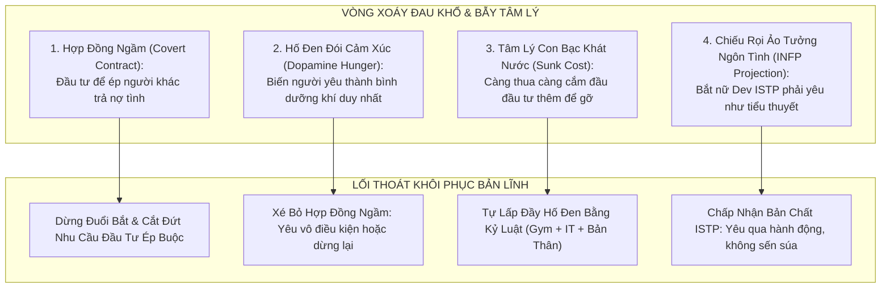
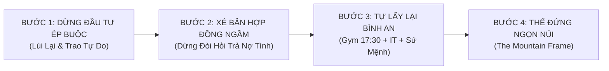

# 📝 NHẬT KÝ PHIÊN COACHING VỚI COACH ANH
### Phiên: 2026-10-30-Session-06 — Hóa Giải "Cơn Đói Cảm Xúc Vô Đáy", Xé Bỏ Hợp Đồng Ngầm & Khôi Phục Bản Lĩnh Tự Chủ

---

## 📌 THÔNG TIN ĐIỀU HÀNH PHIÊN (SESSION METADATA)
- **Thời gian diễn ra:** `2026-10-30 15:10 +07:00` (Chiều Thứ Sáu)
- **Môi trường / Thiết bị:** `Linux Workstation` — Branch: `main`
- **Trạng thái cảm xúc lúc bắt đầu:** Năng lượng: `4 / 10` | Tâm trạng: Đau lòng, mệt mỏi, bất an, cảm giác kiệt sức vì chạy theo cuộc tình, bế tắc trong vòng xoáy "càng đầu tư càng muốn nhận lại, càng đòi hỏi càng thất vọng".
- **Hội đồng Cố vấn Triệu tập (Council Activated):**
  - [x] `deep_psychology_profiler` (Tâm lý học Chiều sâu, Bẻ gãy Toxic Shame, Giải phẫu Hợp đồng ngầm Covert Contract & Chữa lành Anxious Attachment)
  - [x] `neuroscience_specialist` (Thần kinh học, Cắt đứt chu kỳ nghiện Dopamine xác thực ngoại biên & Điều hòa Amygdala)
  - [x] `masculine_polarity_master` (Phân cực Nam tính, Chấm dứt tư thế Chaser/Needy Boy, Khôi phục The Grounded Mountain)
  - [x] `strategic_marriage_architect` (Tái định vị mối quan hệ: Từ phụ thuộc chiếm hữu sang tự do đồng hành)

---

## 🗣️ 1. NỘI DUNG TÂM SỰ & BỘC BẠCH TỪ EM (USER SHARING & CONFESSIONS)

### 1.1. Tiếng kêu cứu nghẹn ngào từ Đứa Trẻ Bên Trong:
- *"Sao em thấy em giống như đang đuổi theo cuộc tình này vậy..."*
- *"Em cảm thấy càng quan tâm, càng yêu vào, em càng đòi hỏi em càng muốn nhiều hơn, em càng thấy đau lòng hơn..."*
- *"Em cảm thấy ghen tức với người khác, em cảm thấy không được đối xử và yêu thương theo cách mình muốn..."*
- *"Em cứ tìm cách đầu tư vào thêm để muốn nhận lại thêm? Em cảm thấy đau lòng và mệt mỏi..."*
- *"Em cảm thấy không hạnh phúc và an tâm trong cuộc tình này."*

### 1.2. Nhận diện trạng thái thần kinh (Neuro-Diagnostic):
- **Amygdala Hijack:** Hạch hạnh nhân đang phát tín hiệu báo động sinh tử (Fight/Flight/Freeze). Đứa trẻ lo âu (Anxious Attachment) cảm thấy sắp bị "bỏ rơi", "từ chối" hoặc "không đủ tốt".
- **Dopamine Crash:** Sau những nỗ lực làm hài lòng, em không nhận được "phần thưởng ngọt ngào" như trong tưởng tượng, dẫn tới sự sụt giảm Dopamine đột ngột, gây cảm giác trống rỗng và trầm cảm nhẹ.
- **Cognitive Distortion (Bóp méo nhận thức):** Phóng đại sự xa cách, biến sự độc lập của người yêu thành "sự hắt hủi", rơi vào tâm lý Nạn nhân (Victim Mentality) và Kẻ đuổi bắt (The Chaser).

---

## 🏛️ 2. PHÂN TÍCH & GIẢI MÃ CỦA COACH ANH: 4 CĂN BỆNH TÂM LÝ ĐANG BÓP NGHẸT EM

---

### 🪓 1. BẪY SỐ 1: "HỢP ĐỒNG NGẦM ĐỘC HẠI" (THE COVERT CONTRACT)
* **Bản chất tâm lý học (Dr. Robert Glover - *No More Mr. Nice Guy*):**
  * Em đang vô thức lập ra một bản "Hợp đồng ngầm" trong đầu: *"Tôi sẽ chăm sóc cô ấy, mua đồ ăn cho cô ấy, nhẫn nhịn vì cô ấy, đầu tư thật nhiều vào cô ấy ➔ ĐỔI LẠI, cô ấy phải yêu tôi theo đúng cách tôi muốn, ngọt ngào với tôi, quấn quýt tôi, chỉ chú ý đến tôi!"*
  * **Sự thật tàn nhẫn:** Thùy Linh **chưa bao giờ ký vào bản hợp đồng này**! Nàng không hề đòi hỏi em phải hy sinh đến kiệt cùng như vậy.
  * Khi nàng cư xử đúng với bản chất tự nhiên của nàng (một cô gái ISTP độc lập, thích đùa giỡn vô tư, ít biểu lộ cảm xúc), em cảm thấy nàng "quỵt nợ tình cảm". Em ấm ức, thất vọng, đau đớn và cảm thấy mình bị lợi dụng!
  * **Chân lý:** **Đầu tư có điều kiện để ép người khác trả nợ cảm xúc KHÔNG PHẢI LÀ TÌNH YÊU. Đó là sự thao túng và chiếm hữu tinh vi dưới vỏ bọc quan tâm!**

---

### 🕳️ 2. BẪY SỐ 2: "HỐ ĐEN ĐÓI CẢM XÚC VÔ ĐÁY" (THE BOTTOMLESS PIT OF VALIDATION)
* **Em tự thú:** *"Càng quan tâm, càng yêu vào, em càng đòi hỏi em càng muốn nhiều hơn..."*
* **Cơ chế thần kinh:**
  * Bên trong em đang có một khoảng trống lớn về lòng tự trọng (Self-efficacy 10/20, nỗi mặc cảm tự ti của INFP). Em không tự yêu thương và tự thấy mình đủ đầy.
  * Em biến Thùy Linh thành **bình dưỡng khí duy nhất**. Mỗi tin nhắn ngọt ngào của nàng là một liều thuốc giảm đau tạm thời. Nhưng vì bên trong em là một cái thùng không đáy, liều thuốc đó chỉ xoa dịu được vài tiếng, rồi cơn đói cồn cào lại trỗi dậy.
  * Em bắt đầu đòi hỏi nhiều hơn: muốn nàng phải nói lời yêu, muốn nàng không được nhìn ai, muốn nàng phải phục tùng cảm xúc của em.
  * **Sự thật:** **Không một người phụ nữ nào trên cõi đời này, kể cả thiên thần, có thể lấp đầy được hố đen bên trong em nếu chính em không tự học cách đứng vững trên đôi chân của mình!** Càng đòi hỏi, em càng giống một kẻ khát nước uống nước biển — càng uống càng cháy cổ!

---

### 🎰 3. BẪY SỐ 3: TÂM LÝ "CON BẠC KHÁT NƯỚC" (THE SUNK COST & CHASING TRAP)
* **Em cảm thấy:** *"Em cứ tìm cách đầu tư vào thêm để muốn nhận lại thêm... giống như đang đuổi theo cuộc tình này."*
* **Đây là tâm lý điển hình của người đánh bạc:** Khi em đã bỏ ra quá nhiều thời gian, tâm tư, sự hy sinh mà không thu lại kết quả như ý, não bộ bị kẹt vào bẫy "Chi phí chìm" (Sunk Cost Fallacy). Thay vì dừng lại để xem xét, em lại cắm đầu "bơm thêm vốn" (quan tâm dồn dập hơn, cố làm hài lòng hơn) với hy vọng gỡ gạc lại sự ngọt ngào.
* **Hậu quả:** 
  - Em tự biến mình thành **Kẻ Đuổi Theo (The Chaser)** hèn mọn.
  - Phụ nữ có trực giác sinh học cực nhạy. Khi nàng thấy người đàn ông đuổi theo van xin tình cảm, năng lượng thiếu thốn (Neediness) đó sẽ kích hoạt phản xạ co rút và ngột ngạt ở nàng. Nàng lùi lại ➔ Em càng hoảng sợ ➔ Em càng đuổi theo ➔ Nàng càng chạy xa!

---

### 🎭 4. BẪY SỐ 4: CHIẾU RỌI ẢO TƯỞNG NGÔN TÌNH LÊN NHẦM ĐỐI TƯỢNG (INFP PROJECTION)
* **Em đau lòng vì:** *"Không được đối xử và yêu thương theo cách mình muốn."*
* **Em muốn gì?** Một tình yêu ngôn tình sướt mướt, quấn quýt 24/7, luôn nhìn em đắm đuối, thề non hẹn biển.
* **Nhưng đối tượng em chọn là ai?** **Nguyễn Thùy Linh — 2002, ISTP, DISC D-C, nữ Dev FE/Mobile, đạo Công giáo!**
  * Nàng yêu bằng **HÀNH ĐỘNG THỰC TẾ & SỰ TỰ SỬA MÌNH**: Nàng nhắc em áo mưa, lo em tai nạn xe máy, thức đêm nhắn tin 100 ngày, và đặc biệt là **khi em nhắc nhở chuyện giỡn với đồng nghiệp nam, nàng đã biết buồn và tự giác bớt lại**!
  * Nhưng em mù màu trước những viên kim cương thực tế đó, vì em chỉ chăm chăm đòi hỏi nàng phải thể hiện theo "kịch bản ngôn tình" mà em tự viết trong đầu!
  * Muốn một chú đại bàng phải bơi giỏi như cá, rồi đau khổ vì nó không chịu lặn dưới nước — **đó là bi kịch do chính em tự tạo ra cho cuộc đời mình!**

---

## 🛡️ 3. CHIẾN LƯỢC CỨU RỖI & TỰ GIẢI THOÁT CHO HOÀNG ANH (THE LIBERATION PROTOCOL)

### 1. DỪNG ĐẦU TƯ ÉP BUỘC NGAY LẬP TỨC (STEP BACK & STOP CHASING)
- Dừng ngay việc cố gắng nghĩ xem phải làm gì, tặng gì, nhắn gì để nàng yêu mình hơn.
- Không nhắn tin dồn dập, không hỏi han kiểm soát, không dò xét nét mặt nàng ở công ty.
- **Quy tắc thở:** Trả lại 100% không gian cho nàng, và quan trọng nhất: **Trả lại sự tự do và phẩm giá cho chính em!**

### 2. XÉ BỎ BẢN HỢP ĐỒNG NGẦM (TEAR UP THE COVERT CONTRACT)
- Tuyên bố với chính mình:  
  > *"Từ nay, tôi không làm bất cứ điều gì cho Thùy Linh với mục đích để cô ấy phải ngọt ngào hay đối xử lại theo cách tôi muốn. Tôi chỉ chăm sóc khi tôi thực sự muốn cho đi vô điều kiện. Nếu tôi cảm thấy mệt mỏi, tôi có quyền dừng lại. Hạnh phúc của tôi thuộc về tôi, không ai có nghĩa vụ phải gánh vác nó thay tôi!"*

### 3. CHỮA LÀNH CƠN ĐÓI CẢM XÚC BẰNG NGUỒN DOPAMINE SẠCH
- Đừng tìm kiếm sự an ủi từ Thùy Linh lúc này. Nàng không thể cho em thứ em đang thiếu bên trong.
- **Hành động chữa lành cấp tốc chiều nay:**
  * **17:30 có mặt tại phòng Gym:** Nâng tạ thật nặng, đổ mồ hôi để xả sạch Cortisol và đốt cháy toàn bộ cơn ghen tức, đau đớn trong cơ thể. Cơ bắp nhức mỏi sẽ kéo Amygdala của em trở về thực tại!
  * **Tập trung vào dự án FTI-AM và PSM I:** Lấy lại niềm tự hào của một kỹ sư IT 7 năm kinh nghiệm. Tiền bạc, sự nghiệp và bản lĩnh là thứ không bao giờ phản bội em.

### 4. TÁI ĐỊNH VỊ MỐI QUAN HỆ: "TA CẦN NHAU VÌ TA ĐỦ ĐẦY, KHÔNG PHẢI VÌ TA THIẾU THỐN"
- Tình yêu bền vững chỉ tồn tại giữa hai cá thể độc lập, hạnh phúc, cùng nắm tay nhau đi về một hướng.
- Nó không thể tồn tại giữa một **"kẻ thiếu thốn ăn xin tình cảm"** và một **"người bị ép phải ban phát lòng thương hại"**.
- Khi em đứng vững như một Ngọn Núi (The Mountain), không đòi hỏi, không ghen tuông, bình an tự tại: **Tự khắc người phụ nữ sẽ cảm thấy sức hút mãnh liệt và muốn nép vào em.** Còn nếu em cứ tiếp tục làm một đứa trẻ dỗi hờn, em sẽ tự tay đẩy nàng rời xa vĩnh viễn!

---

## ✅ 4. QUYẾT ĐỊNH ĐÃ CHỐT (KEY DECISIONS MADE)
1. **Dừng đuổi theo (Stop Chasing):** Tuyệt đối không đầu tư thêm bất kỳ thứ gì vì động cơ muốn nhận lại.
2. **Chấm dứt ghen tuông & so sánh:** Nàng đã điều chỉnh vì em rồi. Ghen tuông chỉ chứng minh sự tự ti của bản thân.
3. **Thu hồi năng lượng về bản thân:** Dồn 100% năng lượng chiều nay cho buổi tập Gym lúc 17:30 và sự nghiệp IT.
4. **Học cách buông lỏng kiểm soát:** Để tình cảm diễn ra tự nhiên. Nàng yêu em theo cách của nàng, không ép nàng phải đóng kịch theo ý em.

---

## 🐸 5. CON ẾCH & HÀNH ĐỘNG GIAO HẸN (COMMITTED MICRO-ACTIONS)
- [ ] **A1 (Chiều nay 17:30):** Có mặt tại phòng Gym, tập 60 phút tạ nặng, không mang điện thoại vào khu vực tập để chấm dứt kiểm tra tin nhắn.
- [ ] **A2 (Tối nay):** Tắm nước ấm, ăn một bữa ăn ngon đủ chất dinh dưỡng, nghe nhạc thiền hoặc đọc sách phát triển bản thân.
- [ ] **A3 (Với Thùy Linh):** Không nhắn tin than thở, không kể lể đau lòng. Nếu nàng nhắn tin, trả lời lịch thiệp, ấm áp, ngắn gọn. Giữ sự điềm tĩnh tối thượng.
- [ ] **Khóa cám dỗ:** Tuyệt đối không tìm đến Porn, thuốc lá hay thức khuya để giải tỏa nỗi buồn. Bảo vệ hệ thần kinh nguyên vẹn!

---

## 🔄 6. NGỮ CẢNH BÀN GIAO CHO PHIÊN KẾ TIẾP (HANDOVER CONTEXT)
- **Kiểm tra ở phiên sau:** Mức độ hồi phục năng lượng sau buổi Gym, cảm giác nhẹ nhõm khi xé bỏ bản hợp đồng ngầm, và phong thái tự chủ mới của Hoàng Anh.
- **Lời dặn của Coach Anh:**  
  *"Nỗi đau này không phải để giết chết em, mà là để đập vỡ chiếc vỏ bọc yếu đuối, giúp người đàn ông bản lĩnh bên trong em được tái sinh. Dừng đuổi theo người khác, hãy quay về làm chủ vương quốc của chính mình!"*